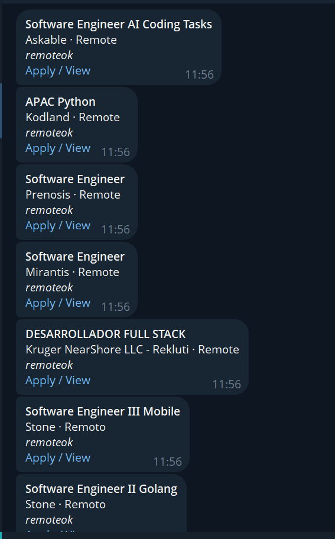
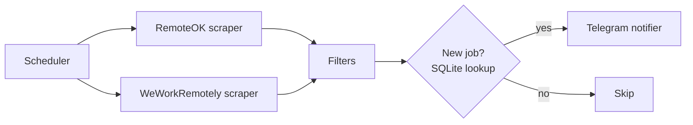

# Job Alert Bot

A Python bot that scrapes remote job boards on a schedule, filters listings by keyword, and sends new matches straight to Telegram. Each job is alerted only once, so the feed stays clean.



## Features

- **Multiple sources** behind a common scraper interface (RemoteOK JSON API, We Work Remotely RSS)
- **Keyword filtering** with include, exclude, and location rules, all configured in `config.yaml`
- **Deduplication** with SQLite, so you never get the same job twice
- **Scheduled runs** every N minutes using APScheduler
- **Resilient fetching** with retries and exponential backoff
- **Failure alerts**: if a scraper breaks, you get a Telegram message instead of silence
- **Seed mode** to record existing jobs on the first run without sending hundreds of alerts
- **Tested** filter and dedupe logic with pytest, plus a Dockerfile

## How it works



1. The scheduler triggers each configured scraper.
2. Every scraper returns jobs in a shared `Job` format.
3. Filters drop anything that matches an exclude keyword or doesn't match an include keyword.
4. Jobs not already in SQLite are saved and sent to Telegram.

## Tech stack

Python 3.10+, requests, PyYAML, APScheduler, SQLite, python-dotenv, pytest, Docker

## Getting started

### 1. Clone and install

```bash
git clone https://github.com/dalavaivaishnavi/job-alert-bot.git
cd job-alert-bot
python -m venv .venv
# Windows: .venv\Scripts\activate    macOS/Linux: source .venv/bin/activate
pip install -r requirements.txt
```

### 2. Create a Telegram bot

1. Message `@BotFather` on Telegram, send `/newbot`, and copy the token.
2. Send any message to your new bot.
3. Open `https://api.telegram.org/bot<TOKEN>/getUpdates` and copy your `chat.id`.

### 3. Configure

```bash
cp .env.example .env     # Windows: copy .env.example .env
```

Fill in `.env`:

```
TELEGRAM_TOKEN=your-bot-token
TELEGRAM_CHAT_ID=your-chat-id
```

Edit `config.yaml` to set your keywords:

```yaml
interval_minutes: 60
filters:
  include_keywords: ["python", "backend", "software engineer"]
  exclude_keywords: ["senior", "lead", "manager"]
  locations: []
sources:
  - remoteok
  - weworkremotely
```

### 4. Run

```bash
python main.py --seed   # first run: mark current jobs as seen, no alerts
python main.py --once   # single pass, then exit
python main.py          # run now, then every interval_minutes
```

### Docker

```bash
docker build -t job-alert-bot .
docker run -d --env-file .env job-alert-bot
```

## Tests

```bash
pytest
```

## Project structure

```
job-alert-bot/
├── scrapers/          # base class + one module per job source
├── db.py              # SQLite dedupe store
├── filters.py         # keyword and location matching
├── notifier.py        # Telegram messages
├── main.py            # CLI entry point and scheduler
├── config.yaml        # filters, sources, interval
├── tests/
└── Dockerfile
```

## Adding a new source

1. Create `scrapers/yoursite.py` with a class extending `BaseScraper` and a `scrape()` method that returns a list of `Job` objects.
2. Register it in `scrapers/__init__.py`.
3. Add its name to `sources` in `config.yaml`.

## Roadmap

- Telegram commands (`/add_keyword`, `/list`, `/pause`)
- Configurable database path for persistent volumes in Docker
- Resume matching: score each job against a resume with embeddings
- More sources (company career pages)

## Notes

Respect each site's terms of service and robots.txt. This project is intended for personal use with sites that offer public feeds or APIs.
